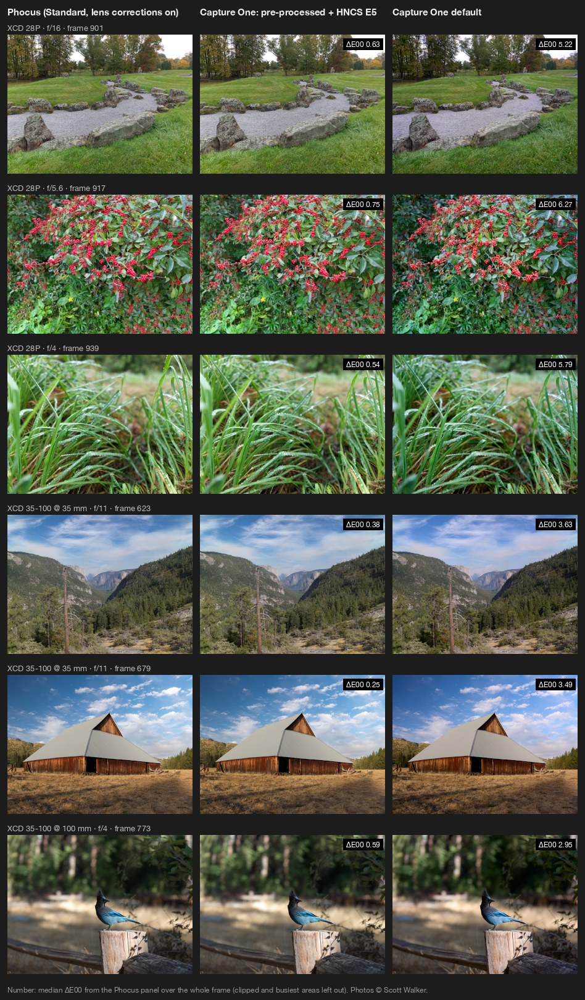

# HNCS for Capture One

Camera profiles and styles that make Capture One render **Hasselblad X2D II 100C** raws the way
Hasselblad's Phocus does with its Natural Colour Solution (HNCS). They were fitted to Phocus's own
output and checked against real Capture One renders. At the frame centre they land a median of about
0.5–0.6 ΔE00 from Phocus on frames never used in fitting (CIEDE2000 colour difference; around 1 is about
the smallest difference you can see side by side).



*Left: Phocus (Standard preset, lens corrections on). Middle: Capture One with an earlier HNCS profile
(E3). Right: Capture One's default rendering. Numbers are the median colour difference from Phocus over
the whole frame. Details in [docs/results.md](docs/results.md).*

This is a personal project. It's not affiliated with Hasselblad or Capture One.

## Two ways to use it

| | Simple: **HNCS E4** | Best: **HNCS E5** + LCC |
|---|---|---|
| What | one profile for every lens | a profile per lens, plus a colour LCC per lens |
| Frame centre, held-out frames (28P / 35-100) | 0.69 / 0.72 | **0.50 / 0.52** |
| Whole frame vs Phocus with corrections on (28P / 35-100) | 2.23 / 0.94 | **1.51 / 0.73** |
| Setup | copy two files, restart | the same, plus one LCC per lens |

E5 exists for the XCD 28P and XCD 35-100. For other lenses use E4.

## Install

Tested with Capture One 16.9 and Phocus 4.2.2 on macOS.

1. Copy the files in `profiles/` to `~/Library/ColorSync/Profiles/`.
2. Copy the files in `styles/` to `~/Library/Application Support/Capture One/Styles/`.
3. Restart Capture One. New profiles and styles only appear after a restart.

## Use: HNCS E4

Apply **HNCS E4 + Light Falloff 120** (what Phocus gives with lens corrections on), or **HNCS E4** to
set lens correction yourself.

## Use: HNCS E5 with an LCC

Phocus shades colour across the frame, warmer toward the edges, by an amount that depends on the
lens, even with lens corrections off. A camera profile can't vary across the frame, but a Capture One
LCC (lens cast calibration) can. So E5 is a centre-accurate profile per lens plus a colour LCC per lens.

**Once per lens**, make an LCC reference from any raw you shot with that lens (its pixels are replaced;
only its metadata is used):

```sh
python3 -m venv .venv && .venv/bin/pip install -r tools/requirements.txt
.venv/bin/python tools/make_lcc_raw.py ANY_28P_RAW.3fr "HNCS LCC 28P.3fr" --colour fit/lcc/colour_28P.npz
.venv/bin/python tools/make_lcc_raw.py ANY_35-100_RAW.3fr "HNCS LCC 35-100.3fr" --colour fit/lcc/colour_35-100.npz
```

Put the reference in your session or catalog, select it, and choose **Create LCC** in the Lens Cast
Calibration tool.

**Per image:**
1. Apply **HNCS E5 28P LCC + Light Falloff 120** (or the 35-100 one).
2. Copy the LCC from the matching reference to your images (Copy/Apply Adjustments, LCC), with
   **Color Cast on** and **Uniform Light off**.

The E5 "LCC" profiles include a correction for the overall colour shift an LCC introduces, so use them
only together with the LCC. Without it they render slightly warm.

**In all cases:**
- Keep the film curve on **Linear Response**. Phocus's tone curve is built into the profiles.
- Use **As Shot** white balance, as you would in Phocus.
- Edit as usual afterwards. The match was measured with every other adjustment at its default.

## Known limits

- **One camera.** Each X2D II carries a factory calibration record that Phocus uses to normalise the
  body and Capture One ignores. The profiles match the body they were made on; another body can differ
  by about 1 b*.
- **White balance.** Phocus's colour shifts with white balance. The profiles are an average over
  about 4700–6300 K. At tungsten (about 3400 K) they're 1.6–2.1 ΔE00 off.
- **XCD 28P at f/5.6 and narrower.** Phocus corrects vignetting more strongly than Capture One's Light
  Falloff 120, so the edges stay darker than Phocus (it matches at f/4).
- **Variation between frames.** Some frames come out 0.5–1 L* darker than Phocus overall.

More in [docs/open-questions.md](docs/open-questions.md).

## How it was made

**E1–E4** were fitted to real photographs rendered in both apps. Each raw was rendered by Phocus (with
everything but colour and tone switched off) and by Capture One through a "probe" profile that exposes
the exact camera RGB a profile receives. A smooth 33 × 33 × 33 lookup table from camera RGB to
Phocus's Lab was fitted to the pairs.

**E5** was fitted without any real photos. X2D II raws store uncompressed sensor data, so a copy of a
real raw can be filled with colour patches of exactly known camera RGB. Phocus's hot folder renders
them without the GUI. That made it possible to:
- measure Phocus across the whole colour range at several white balances;
- map its spatial shading with synthetic flat fields;
- find which file metadata changes its output: one maker-note entry holding two calibration gains.

The step-by-step notes are in [docs/research-log.md](docs/research-log.md); the overview is in
[docs/methodology.md](docs/methodology.md).

## Repository layout

```
profiles/   HNCS E4 (all lenses); HNCS E5 28P LCC, HNCS E5 35-100 LCC
styles/     a plain and a "+ Light Falloff 120" style for each profile
fit/        lut_e4.npz, lut_e5_28p.npz, lut_e5_35-100.npz   fitted 33³ tables before ICC encoding
            lcc/          colour shading maps for the LCC references, and the profiles' input gains
            synthetic/    Phocus's renders of the synthetic patches (camera RGB → Lab) and flat-field maps
            configs/      frames and settings of the E4 fit
docs/       results, methodology, research log, open questions, original design, contact sheet
tools/      Python and AppleScript: synthetic raws, pairing, fitting, profiles, LCCs, validation
```

Earlier versions (E1–E3) are in the git history.

## Experimenting

- **Edit a table and re-export.** Each `fit/lut_*.npz` holds a fitted table (`lut`, 33³ × Lab):
  `python tools/write_profile.py fit/lut_e5_28p.npz "HNCS Mine" out/`
- **Refit from the synthetic data** in `fit/synthetic/`, no Phocus needed.
- **Measure your own camera or another lens** with synthetic raws: see [tools/README.md](tools/README.md).

## Credits

[blog.tonalphoto.com](https://blog.tonalphoto.com/) for the Lightroom profile that inspired this, and
for its measurements of Phocus (HNCS and white balance, edge brightening, BaselineExposure, lens files
in the firmware, the Phocus hot folder).

## License

[MIT](LICENSE) for the profiles, styles, tables, data, tools and docs. The example photographs in
`docs/images/` are © Scott Walker, all rights reserved.
