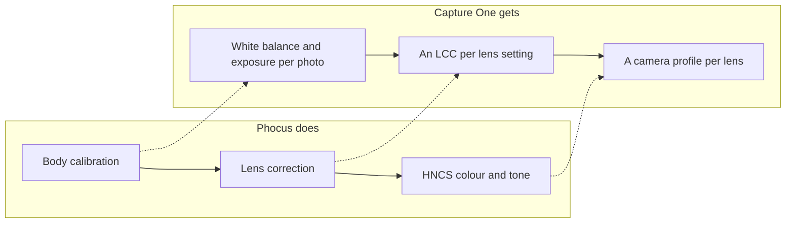

# Methodology

How the profiles and lens corrections are made, and why each piece works. To run it, see
[../tools/README.md](../tools/README.md). The measurements behind every statement here are in
[research-log.md](research-log.md), and replaced approaches are in [history.md](history.md).

## The idea

Phocus renders Hasselblad raws with the Hasselblad Natural Colour Solution (HNCS). Capture One can't run
HNCS, but it accepts any camera profile you give it, and its settings files can carry a per-photo lens
correction, exposure and white balance. So the approach is to measure what Phocus does and store it in
those two places:

Both apps are measured with **synthetic raws**: copies of a real X2D II raw whose pixels are replaced by
designed values (grids of colour patches, or a flat grey). Both apps render them like any other raw, and
because the input is known exactly, each patch gives one exact pair of Capture One input and Phocus output.

## What Capture One does with a camera profile

- Camera profiles are ICC v2.4, class `scnr`, RGB → Lab. The table is an `mft2` A2B0 tag: 1025-entry
  input curves, a 33³ grid, and Lab in the legacy 16-bit encoding.
- The neutral axis of the bundled ProStandard profile is a pure gamma-1.8 decode. So the profile
  receives white-balanced camera RGB, gamma-1.8 encoded, and contains no tone curve; tone lives in the
  separate film curve (`.fcrv`). The HNCS profiles include Phocus's tone, so they're used with the Linear
  Response film curve.
- Capture One interpolates the table **tetrahedrally**. The fit models it the same way.
- A profile named `HasselbladX2DII100C-<Name>.icm` in `~/Library/ColorSync/Profiles` lists under the
  camera as "Hasselblad X2D II 100C <Name>" after a restart. A byte-for-byte copy of ProStandard renders
  pixel-identical, so user profiles are treated like bundled ones.
- ProStandard carries a private `P100` tag. It only changes the render with the Film Standard curve,
  so the profiles leave it out.
- Light Falloff and LCCs are applied before the profile, in linear raw space.

**The probe profile.** To see exactly what the camera profile receives, `build_probe.py` writes a
profile that treats the camera RGB as ROMM RGB. Render through it, export to ROMM RGB 16-bit, and the
TIFF holds the camera RGB itself. It matches the expected values to about 0.07 ΔE00 from L* 30 up.

## Measuring Phocus

- **Writing raws.** X2D II raws store the sensor data uncompressed (RGGB, 16-bit, black 4096).
  `make_synthetic_raw.py` replaces a copy's active area with patches or a flat. White balance is set by
  writing another frame's AsShotNeutral (IFD0 and the maker-note copy); both apps read it. Copies get
  BaselineExposure 0 and the reference body's factory gains (below).
- **Driving Phocus without its GUI.** `phocus_hotfolder.py` turns on Phocus's hot folder (`AutoExport`,
  `exportDirectory`), points it at a private folder under `~/Pictures` (macOS won't let Phocus read one
  under `~/Documents`) by appending a bookmark to its `ThumbnailsRecent` list, drops a `.phos` sidecar with
  the wanted settings and then the raw, waits for the export to finish writing (Phocus creates it empty
  first), and restores the preferences afterwards. Each export takes about 10 s.
- **Capture One's side.** Capture One turns each synthetic patch value into the same camera RGB whatever
  the lens or white balance (spread 0.0003 across 24 grids), so its side of every pair comes from
  `fit/c1_patch_lookup.npz`, measured once through the probe. Its per-channel response curve alone isn't
  enough: for very saturated patches Capture One mixes into the empty channel.
- **What Phocus reads from a raw.**
  - The lens: a 34-byte lens identity in maker-note entries 0x0017 and 0x0018, looked up in data built
    into Phocus (Findings 29, 30). The EXIF lens name does nothing.
  - The focus distance: byte 6 of 0x0018 (Finding 31).
  - The body: a factory "GAIN" calibration record in maker-note entry 0x0019, of which only two
    half-float channel gains matter (Findings 13, 16).
  - White balance and BaselineExposure. Firmware string and serial number have no effect.

## The colour profile per lens

Per lens, `auto_lens_profile.py` writes three 33-level patch grids at the host raw's white balance, five
22-level grids at five daylight white balances (blue/red 1.32 to 1.86), and a flat field, all into copies of
one of the lens's raws. Phocus renders them with lens corrections off. That gives about 82,000 patches.

Even with lens corrections off, Phocus applies a lens-specific spatial gain: a brightness lift and a
colour shading (less blue) toward the edges. `flat_gain.py` measures it from the flat, and each patch is
corrected by the gain at its position, so the table describes the centre of the frame.

`fit_synthetic.py` then solves for the table L (35,937 nodes × Lab) by sparse least squares:

(WᵀW + λs·DᵀD + λr·I) L = Wᵀ·Lab + λr·Base

- **W**: each patch's tetrahedral weights on the 33³ grid. **Lab**: Phocus's output for the patch.
- **D**: second differences along each grid axis, so the table stays smooth where the data is thin
  (λs = 1).
- **Base**: a smooth parametric model (3 × 3 matrix → ProPhoto → a shared monotone tone curve), fitted
  to the same data. A tiny ridge (λr = 0.001) pulls nodes with no data toward it.
- **Storable range.** Lab in the profile must sit in L* 0–100 and within the encoding. Nodes outside are
  pinned to clipped values and the fit is re-solved around them, so the clipping doesn't put kinks next
  to real data. The encoding limits a* and b* separately (about ±128 each), so where either passes 110
  the two are compressed together toward that limit, keeping the hue. Chroma fades to neutral above
  table L* 100, and for near-neutral nodes (C* under 6) from L* 95, so whites stay clean while saturated
  yellows at L* 98 keep their colour.

One table can't follow Phocus's white-balance dependence exactly (about 0.5–1 ΔE00 per 25% change in the
blue/red balance, Finding 8), so it settles on the average across the six. That covers about 4700 to
6300 K. Tungsten profiles are fitted the same way on tungsten white balances (about 3100 to 4200 K,
Finding 21) and picked automatically below 4400 K. Shade profiles are fitted on grids at 6300 to 8600 K
(`auto_lens_profile.py --light shade`, Finding 44) and picked above 6200 K. Their grids sit where real X2D II
As Shot neutrals do: about 5% lower in red and 6% lower in blue than the ColorMatrix1 daylight locus.

`write_profile.py` writes the table using the ProStandard header and L*-spaced input curves, with the
lens's LCC colour factor built into the input curves (below).

## Body calibration

Phocus normalises each body with the two factory gains in its GAIN record; Capture One ignores them. The
effect is a green and a blue gain on the camera RGB: kG = (g1 / 2.600)^0.077 and kB = (g2 / 2.260)^0.078,
relative to the body the profiles were made on (Findings 13, 16, 35). All synthetic copies carry that
reference body's record, so the profiles and lens corrections describe one body, and each photo's settings
file applies its own body's gains through white balance and exposure.

`bake_lcc_colour.py --body RAW` builds one camera's gains into the profiles it installs instead (through
Capture One's raw response, like the LCC colour factor) and records them in `data/installed_body.json`.
Settings files then leave them out of that camera's photos, so changing white balance in Capture One keeps
the correction (Finding 48). The repo's profiles stay made for the reference body.

## Lens correction: settings files and LCCs

Phocus's lens correction is a fixed multiplier on the raw values, per channel, that depends on lens, focal
length, aperture and focus distance (Findings 22, 27, 31). Capture One reproduces it with an LCC, written
into its settings file for each raw before import (Findings 39 to 42):

1. **Measure the correction.** A synthetic flat (L\* 30) with the lens setting of a real raw is rendered by
   Phocus with lens corrections on. `flat_gain.py` inverts it through the lens's table into a per-channel
   gain map, and `make_preprocess_map.py` converts that into raw-domain gains through Capture One's
   response curve (`fit/c1_response.npz`). Maps are cached by lens setting in `fit/preprocess_maps/`;
   `auto_maps.py` makes missing ones.
2. **Turn it into an LCC.** `state_lcc.py make` writes a synthetic LCC reference whose pixels are the
   inverse of the map, per channel, and runs Capture One's Create LCC on it. With colour cast and uniform
   light on, the LCC reproduces the map in 2-D to about 0.015 stop. Phocus's correction is elliptical and
   slightly off-centre, which a radial Light Falloff curve can't follow, and uniform light turns Light
   Falloff off anyway.
3. **Calibrate the LCC.** An LCC also shifts the overall colour and brightness a little. `state_lcc.py
   calibrate` measures that on three flat fields in Capture One's own output: one with the map multiplied
   into the raw itself and no LCC, which is Phocus's correction exactly; one with the LCC; and one with the
   LCC plus a known exposure and white-balance step. It compares them over the frame (r 0.05 to 0.9) and
   stores the exposure and red/blue factors that cancel the difference. The comparison has to cover the
   frame: the LCC differs from the map at a small spot in the very centre, and a calibration taken there
   leaves the rest of the photo up to 0.04 stop off (Finding 43).
4. **Write a settings file per raw.** `c1_sidecars.py` writes `CaptureOne/Settings<version>/<raw>.cos`
   beside each raw, before Capture One first sees it: the profile (the tungsten one below about 4400 K, the
   shade one above about 6200 K),
   Linear Response, the lens setting's LCC (copied beside it as `<raw>.<id>.lcc`), exposure for Phocus's
   lens-setting brightness (Finding 27), and white balance as the raw's As Shot multipliers times the LCC's
   calibration and the body's gains, divided by the lens's colour factor that the profile already applies
   (step 5). A settings file needs the image UUID, `Version` and a `VAR` with `ProductID` and its own UUID,
   or Capture One ignores it.
5. **Build the lens's colour factor into its profiles.** The LCC's colour shift comes from Capture One
   normalising each channel of the LCC by its own average, which ignores the sensor margin outside the crop,
   so it can't be cancelled inside the LCC (Finding 47). It is nearly the same for every setting of a lens
   (28P: red ×1.017–1.020, blue ×0.960–0.965). `bake_lcc_colour.py` writes each lens's average into all its
   profiles and records it in `fit/lcc_colour.json`. The factor goes into the profile's input curves through
   Capture One's raw response (`fit/c1_response.npz`), so it acts exactly like a white-balance multiplier: the
   response has a toe, and a raw multiplier counts for 1.4 to 1.9 times as much in the shadows as the same
   gain applied after it. Only the small per-setting remainder
   is then left in the white balance, so choosing another white balance in Capture One keeps the colour
   right. Without an LCC yet, a lens's factor is estimated from its maps (each channel's mean of 1/map),
   within about 0.005 of calibration.

`prepare_folder.py` runs all of it for a folder of raws. A lens setting without an LCC gets a radial Light
Falloff curve from its map instead, which is less accurate.

## How it's checked

Photos that weren't used to build anything are rendered in Phocus (Standard, lens corrections on) and in
Capture One with their settings files. `score_render.py` aligns the two (phase correlation), cuts both
into blocks, leaves out clipped and near-black blocks and the busiest 30% (fine detail, where a sub-pixel
offset dominates), and reports the median ΔE00 over the frame and by distance from the centre. `contact_sheet.py` builds the side-by-side image in the README from the same renders.

## Gotchas

**Phocus**

- The factory TIFF-16 output preset is locked to Adobe RGB. Duplicate it to pick ProPhoto.
- HDR mode produces a PQ-encoded TIFF. Turn it off.
- Modify → Current copies one image's white-balance numbers to every selected image. The Modify
  dialog also starts with every box ticked, so applying a preset to a batch through it copies white
  balance too. Afterwards, check each sidecar's `ColorTemperature`: 0 means As Shot.
- Picking As Shot stores the image's own numbers, and the menu then shows "Custom". That renders the
  same as As Shot (0.13 ΔE00 between the two).
- Settings live in `<raw>.phos` sidecars (plists). `CurrentIx` picks the active entry, and they're
  only written when you export. `ReferenceSettingName` shows the preset ("Standard+").
- Exports get renamed with a counter (`B_0004_prv.tif`) and may land in a `Previews` subfolder. Each
  sidecar's `ExportName` records which export came from it.
- Raws can carry a BaselineExposure tag (IFD0 50730). Phocus and Capture One both apply it to real
  photos, but synthetic copies need 0, because the patch lookup was measured at 0.

**Capture One**

- New profiles need a restart to appear.
- A settings file applies only to a raw Capture One hasn't seen before.
- Light Falloff defaults to 100 for XCD lenses.
- Its distortion-correction default varies from image to image (100 on some, 0 on others).
- In AppleScript, `highlight adjustment` −100 recovers highlights and +100 brightens them.
- A session's Output folder is part of the session; delete it and recipes fail with error −43.
- Reset adjustments turns distortion correction back on. Leave it on for a pixel-level comparison
  against a Phocus export that only corrected vignetting, and fine texture shows up as large ΔE.
- See [../tools/README.md](../tools/README.md) for AppleScript quirks.

## Limits

- **One camera model.** The X2D II 100C only. Other X2D II bodies are corrected through their factory
  gains, tested on three bodies.
- **Lenses.** Profiles exist for the 28P, 35-100, 38V, 25V, 55V, 90V, 120 Macro and 135;
  `auto_lens_profile.py` builds more from any raw of the lens.
- **White balance.** The main profiles cover about 4700 to 6200 K, every lens has a shade profile (about
  6200 to 8600 K), and the 28P and 35-100 have tungsten profiles (about 3100 to 4200 K). Mixed light is
  untested.
- **Overall brightness.** About ±0.2 L\* per photo is unexplained (up to 0.5 L\* on one photo).
- **Highlights.** Phocus keeps colour in partly clipped highlights and its Highlight Recovery rebuilds
  clipped channels; Capture One doesn't (Finding 23). No profile can change that.
- **Not modelled.** Phocus HDR mode, its Reproduction responses and other working spaces.

The work list is in [open-questions.md](open-questions.md).
