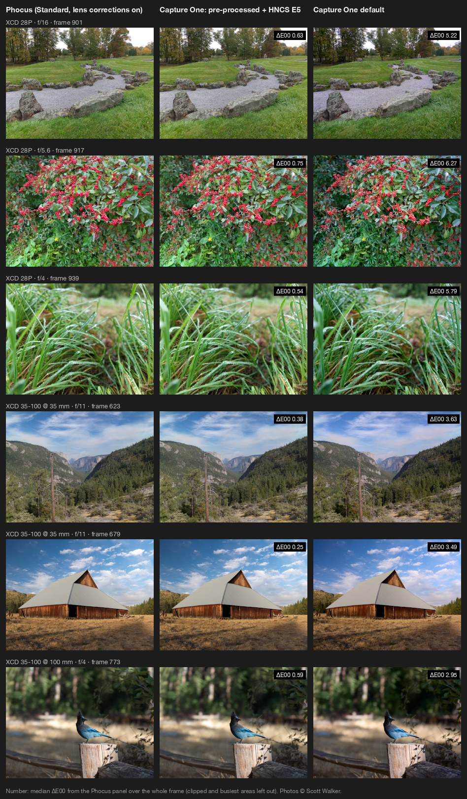

# Results

All numbers are CIEDE2000 (ΔE00) between Capture One and Phocus, computed on per-block mean Lab.
For full-size renders the blocks are 32 × 32 px; for half-size renders, 16 × 16 px, which is the same
area of the frame. Unless stated otherwise, blocks with clipped channels are excluded, and so is
everything beyond 50–60% of the half-diagonal from the centre. "Median" is the median over blocks in
a frame.

**How close is close?** The same camera RGB, in different frames, lands a median of **1.6 ΔE00** apart in
Phocus (6,148 cross-frame pairs from the 28P frames). Blocks mix textures and Phocus does some local
processing, so a per-frame median well under 1 is near the practical floor for this measurement. For
reference, the Lightroom profile by blog.tonalphoto.com that inspired this project reached a median
of 0.94.

## Pre-processed raws + HNCS E5 (closest)

Phocus's lens correction, colour shading and per-lens-setting brightness are written into a copy of the
raw (`tools/preprocess_3fr.py`); Capture One renders the copy with the plain E5 profile, Light Falloff 0
and no LCC. Reference: Phocus with lens corrections on (vignetting), As Shot. Whole frame (r < 0.95),
per 32 px block at 50%, clipped and busiest blocks left out (`tools/score_render.py`).

**23 photos not used in any fit** (Finding 24), median ΔE00:

| | pre-processed + E5 | E5 LCC + LF 120 + colour LCC | E4 + LF 120 |
|---|---|---|---|
| 28P (7 frames) | **0.65** (0.38–0.91) | 1.38 (1.09–1.86) | 2.07 (1.72–2.39) |
| 35-100 (16 frames) | **0.49** (0.26–0.61) | 0.64 (0.44–0.87) | 0.65 (0.35–1.20) |

The pre-processed error is flat from centre to corner; the other routes run several L\* dark in the
28P's corners.

**With the per-lens-setting brightness added** (Finding 27), 14 of those frames re-rendered: mean lightness
offset 0.33 → 0.12 L\*, mean median ΔE00 about 0.55 → 0.47 (for example B0000702 0.65 → 0.50, B0000929
0.75 → 0.51, B0000939 0.54 → 0.42).

**With maps per focus distance** (Finding 31), the three frames whose map changed: B0000929 0.51 → 0.41
(lightness offset −0.18 → +0.05 L\*), B0000916 0.66 → 0.67 (+0.16 → +0.02 L\*), B0000822 0.25 → 0.26.

**XCD 38V** (profile built by `tools/auto_lens_profile.py` from Phocus renders alone, Finding 32), nine of
the owner's frames, none used in fitting: median ΔE00 **0.35–0.53** (mean 0.41), p90 0.54–0.93, flat from
centre to corner, about 0.2 L\* darker than Phocus throughout. Eight of the nine are one scene at
f/2.5–f/8.

## HNCS E5 Tungsten

Fitted on synthetic grids at 3100–4200 K (Finding 21). Three real tungsten-lit 35-100 photos (another
body, its factory gains applied), frame centre, median ΔE00: daylight E5 1.95 / 2.77 / 2.75, E5
Tungsten **1.71 / 1.07 / 1.03**. The 28P tungsten profile is checked on synthetic grids only (0.5 at
3400–3750 K, 1.2 at the ends of the range).

## HNCS E5 with an LCC (profile route)

Fitted only on synthetic raws (colour patches with exactly known camera RGB, written into copies of
the owner's raws and rendered by Phocus): per lens, a 33³ grid at one white balance plus 22³ grids at
five more white balances taken from the owner's frames, about 82,000 patches. Phocus's own spatial
gain (measured with synthetic flat fields) is removed from each patch, so the table describes the
frame centre. Method and all intermediate results: [research-log.md](research-log.md).

Frame centre (r < 0.2), real photos, none used in fitting:

| | E5 | E4 |
|---|---|---|
| XCD 35-100, E4's 5 held-out frames | **0.52** | 0.72 |
| XCD 35-100, all 19 frames | 0.52 | 0.55 (E4 trained on 14 of them) |
| XCD 28P, E4's 3 held-out frames | **0.50** | 0.69 |
| XCD 28P, all 10 frames | 0.59 | 0.69 |

Full chain in real Capture One renders against Phocus with lens corrections on, whole frame
(r < 0.95):

| Frame | E4 + Light Falloff 120 | E5 LCC profile + Light Falloff 120 + colour LCC |
|---|---|---|
| 28P B0000901 (f/16) | 2.19 | 1.56 |
| 28P B0000917 (f/5.6) | 2.11 | 1.56 |
| 28P B0000931 (f/8) | 2.37 | 1.43 |
| 35-100 B0000623 (35 mm) | 1.08 | 0.76 |
| 35-100 B0000679 (35 mm) | 1.10 | 0.69 |
| 35-100 B0000702 (50 mm) | 0.65 | 0.73 |

- 35-100 corners (r 0.8–1.0) improve from 1.2–1.6 to 0.7–0.9.
- On the 28P the edge colour now matches. What remains is edge brightness at f/5.6–f/16 (dL −3 to
  −7 at r 0.6–1.0), where Phocus corrects vignetting more than Light Falloff 120 does.

The LCC references are written from Phocus's measured colour shading (`fit/lcc/`, built into a raw
with `tools/make_lcc_raw.py`). Capture One's LCC colour correction is (reference mean ÷ reference)^1.14
per channel, so the maps are scaled by 0.875, and the E5 "LCC" profiles carry the inverse of the
LCC's overall colour shift in their input curves (`fit/lcc/input_gains.txt`).

## HNCS E4

Fitted on 44 frames from three sources and scored on 17 frames it never saw:

| Source | Frames (train / held out) | Firmware |
|---|---|---|
| Your XCD 28P | 7 / 3 | 1.3.16.2 |
| Your XCD 35-100 | 14 / 5 | 1.3.16.2 |
| [DPReview's X2D II sample gallery](https://www.dpreview.com/sample-galleries/4239298554/hasselblad-x2d-ii-100c-sample-gallery), XCD 35-100 | 23 / 9 (one ISO 25600 frame dropped) | 1.1.6.3 |

The DPReview raws were used for fitting only and aren't redistributed here. They add what the
landscape frames lacked: about 18 portraits across a wide range of skin tones, saturated reds, neon,
sunsets and warm indoor light.

Held-out medians (LUT prediction vs Phocus; E3 for comparison):

| Held-out frames | HNCS E4 | HNCS E3 |
|---|---|---|
| Your 28P (912, 929, 939) | 0.62 / 0.99 / 0.84 → **0.81** | 0.82 |
| Your 35-100 (623, 679, 703, 829, 863) | 0.69 / 0.86 / 0.71 / 0.57 / 0.70 → **0.71** | 0.71 |
| DPReview, with its source offset applied | 0.35–0.83 → **0.57** | 1.24 |
| DPReview portraits (4 of the 9) | 0.35–0.83 | 1.0–1.7 |

Real Capture One renders of the 9 held-out DPReview frames with the `HNCS E4` style: **0.27** from the
LUT's prediction, **0.60** from Phocus with the source offset applied, 0.90 from Phocus without it.

### Greys differ by source

On near-grey blocks, E3's prediction minus Phocus:

| Source | Offset on greys |
|---|---|
| Your body + 35-100 | about +0.2 b* |
| Your body + 28P | −0.5 to −1.4 b* |
| DPReview body + 35-100 | +1.01 b* (±0.18 over 25 frames), about −0.6 a* |

Within a source the offset is steady and doesn't follow white balance (correlation −0.04 over
4900–6500 K). One profile can't match greys for all three, so E4 lets your frames set the overall
balance and gives the DPReview source its own fitted offset (+2.0 b*, −1.1 a*, +0.3 L* at L* 100,
scaling with lightness: about +1.1 b*, −0.6 a* at mid-grey). Your two lenses are averaged. Causes
and tests are in [open-questions.md](open-questions.md).

### White balance range

Rendering the same 33 DPReview raws at As Shot instead of Daylight:

- Frames with As Shot between about 4800 and 6500 K score the same either way.
- The three tungsten-lit frames (As Shot about 3400 K) score **1.6–2.1** at As Shot, against 0.5–0.7
  when rendered at Daylight.

So HNCS E4 covers daylight-range white balance. Tungsten now has its own E5 profiles: 1.0–1.7 on those
frames (research log, Finding 21).

### BaselineExposure

Many X2D II raws carry a BaselineExposure tag (IFD0 50730): 0, +1 or +2 EV on the DPReview frames, up
to +0.76 on the 28P frames, 0 on the 35-100 frames. Both Phocus and Capture One apply it: tagged frames
fit as well as untagged ones, where a missed +1 or +2 EV would show as errors of many ΔE.

## Light Falloff vs Phocus with lens corrections ON

Measured with HNCS E2/E3, not re-measured with E4. On these frames E4 scores within about 0.1 of E3
(their renders differ by a median of 0.1–0.3 ΔE00), so the recommendation should stand.
Phocus's vignetting correction is stronger than Capture One's at the default Light Falloff of 100.
The slider stops at 120.

**XCD 35-100** (HNCS E3; frames 623, 679 @ 35 mm and 702 @ 50 mm; whole frame out to the corners):

| Light Falloff | Mean of frame medians | Lightness gap in the corners |
|---|---|---|
| 0 | 3.43 | −7 to −13 L* |
| 60 | 1.99 | −4 to −7 L* |
| 80 | 1.57 | −3 to −5 L* |
| 100 | 1.21 | −2 to −3 L* |
| **120** | **0.95** | **about −1 L*** |

**XCD 28P** (HNCS E2; frames 901, 917, 931):

| Setting | Mean of frame medians | Lightness gap, 60–80% out → corners |
|---|---|---|
| Light Falloff 100 | 2.99 | −6 → −10 L* |
| **Light Falloff 120** | **1.93** | −3 to −4 → −6 to −7 L* |
| Light Falloff 120 + Vignetting +0.25 EV | 2.03 | right on two frames, overshoots on the third |
| Light Falloff 120 + Vignetting +0.5 EV | 2.79 | overshoots |

So Light Falloff 120 is the right setting for both lenses. The 35-100 then matches Phocus out to the
corners. The 28P's corners stay about half a stop darker; a flat-field (LCC) calibration would close
that. The `+ Light Falloff 120` style renders pixel-identical to setting 120 by hand.

## Contact sheet

- Six of the owner's frames, none used in fitting E5: 28P at f/16, f/5.6 and f/4; 35-100 at 35 mm f/11
  (two) and 100 mm f/4.
- Phocus: Standard preset, lens corrections ON (vignetting only).
- Middle: Capture One rendering a pre-processed copy with `HNCS E5 … (pre-processed)`: whole-frame
  median 0.25–0.75 ΔE00.
- Right: Capture One defaults (ProStandard, Auto curve, Light Falloff 100): 2.95–6.27.
- Distortion correction is off so the panels line up. Made with `tools/contact_sheet.py` before the
  per-lens-setting brightness was added to the maps (Finding 27), which would move the 28P f/4 and
  35-100 100 mm f/4 frames by a few tenths of an L\*.

## Phocus edge brightening with corrections off

Even with lens corrections off, Phocus brightens toward the frame edges. Measured against a
centre-calibrated LUT (r = distance from the centre / half-diagonal):

| Lens | Lift (stops) | At r = 0.3 / 0.5 / 0.6 |
|---|---|---|
| XCD 28P | 0.619 r² + 0.300 r⁴ | 0.06 / 0.17 / 0.26 |
| XCD 35-100 | 0.201 r² − 0.032 r⁴ | 0.02 / 0.05 / 0.07 |

For the 35-100, single frames range from 0.02 to 0.11 stop at r = 0.6, a little less at 75–100 mm
than at 35–60 mm, across f/8 to f/16.

## Highlights

Not a match number, but measured (Findings 23 and 25): at default settings both apps reach white about a
quarter stop before the sensor clips, with the same tones. Where one raw channel clips, Phocus keeps some
colour (median chroma 17 against 0). Phocus's Highlight Recovery rebuilds clipped channels and keeps tone
up to about 1.5 stops past clipping; Capture One's Highlight slider only compresses tones below clipping.
No profile can change this.

## History

Same three held-out 28P frames (912 / 929 / 939):

| Version | What changed | Median ΔE00 |
|---|---|---|
| Capture One default (ProStandard, Auto curve) | — | 4.50 / 3.84 / 3.27 |
| E1, real renders | First fitted profile, 28P only | 0.86 / 1.19 / 0.95 |
| E2, LUT prediction | Phocus edge brightening removed before fitting | 0.62 / 1.07 / 0.81 |
| E3, LUT prediction | Both of your lenses | 0.60 / 1.01 / 0.85 |
| E4, LUT prediction | Plus 32 DPReview frames, anchored to your camera | 0.62 / 0.99 / 0.84 |

E3 real renders (held out, Light Falloff 0, centre 30%): 912 0.67, 929 0.72, 939 0.86, 623 0.81,
679 0.99, 703 0.67, 829 0.63, 863 0.54. E2, fitted on the 28P alone, rendered the 35-100 about 1.5 b*
more yellow than Phocus; E3 fixed that by fitting on both lenses.
