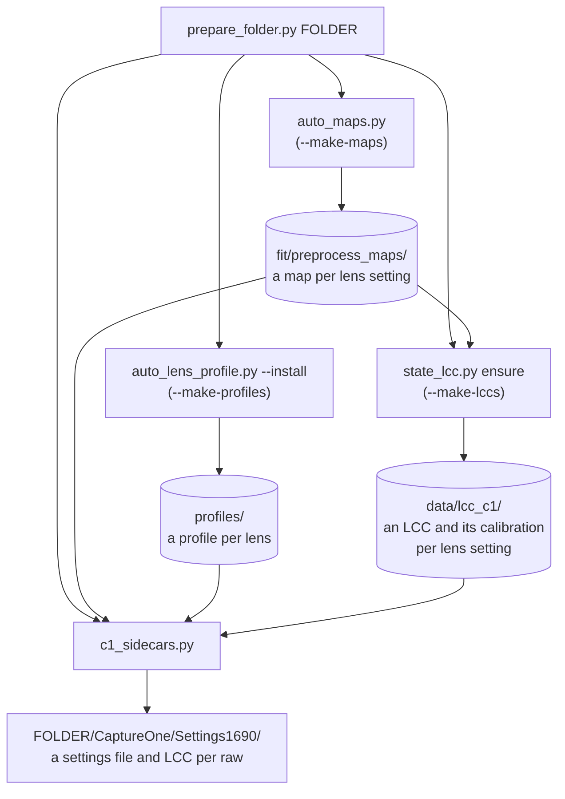

# Tools

The everyday command is `prepare_folder.py` (see the [main README](../README.md)). This page covers the
scripts behind it, and how to build or check profiles yourself. They're written for macOS with Capture
One 16.9 and Phocus 4.2, and for the Hasselblad X2D II 100C. [../docs/methodology.md](../docs/methodology.md)
explains what each step does and why.

## Setup

```sh
python3 -m venv .venv
.venv/bin/pip install -r tools/requirements.txt
```

Run scripts with `.venv/bin/python -I tools/<script>.py …`.

Making LCCs and checking profiles in Capture One need the probe profile: copy
`tools/profiles/HasselbladX2DII100C-E0 Probe.icm` to `~/Library/ColorSync/Profiles` and restart Capture
One. It lists as "Hasselblad X2D II 100C E0 Probe". Rendering a raw through it and exporting to ROMM RGB
16-bit gives exactly the camera RGB that Capture One hands to a camera profile. `build_probe.py`
regenerates it.

## Preparing photos



| Tool | What it does |
|---|---|
| `prepare_folder.py FOLDER [--make-maps] [--make-profiles] [--make-lccs] [--lab DIR] [--force]` | Everything below for a folder of raws, then a settings file per raw |
| `auto_maps.py RAW… [--maps DIR]` | Phocus's lens correction map for every lens setting among the raws that doesn't have one (Phocus, about 25 s each) |
| `auto_lens_profile.py RAW… [--name N] [--install] [--light shade\|tungsten]` | A colour profile for a lens from any of its raws, using only Phocus (about 5 minutes); `--light` makes its shade or tungsten version |
| `bake_lcc_colour.py [--lens NAME…] [--install] [--body RAW\|reference]` | Builds each lens's LCC colour factor (and any brightness correction) into all its profiles and records it in `fit/lcc_colour.json`; `--body` installs profiles with your camera's factory-gain correction built in |
| `state_lcc.py ensure RAW…` | An LCC for every lens setting among the raws that doesn't have one, made and calibrated in Capture One (about 1.5 minutes each) |
| `state_lcc.py make HOST MAP` / `calibrate HOST MAP` | The two halves of `ensure`, for one map |
| `state_lcc.py clean` | Remove the test raws `state_lcc.py` left in the lab session (quit Capture One first) |
| `c1_sidecars.py RAW… [--dest DIR] [--force] [--no-body-gains]` | A Capture One settings file per raw: profile, Linear Response, the lens setting's LCC, exposure and white balance |
| `body_gains.py RAW` | A body's factory gains and the correction they imply (`c1_sidecars.py` applies it automatically) |

A lens setting is lens, focal length, aperture and focus code (byte 6 of maker-note 0x0018). Maps go in
`fit/preprocess_maps/`; a missing focus code falls back to the nearest one measured. LCCs go in
`data/lcc_c1/`, which isn't committed, because an LCC records the camera's serial number.

**The lab session.** `state_lcc.py` needs Capture One open on a session it can add test files to (default
`~/Pictures/X2D Profile`, or `--lab` with that session's Capture folder), and the probe profile installed
before Capture One started. It deletes its test raws as it goes; run `state_lcc.py clean` after quitting
Capture One to remove their leftover settings.

**Settings files.** `c1_sidecars.py` writes `<folder>/CaptureOne/Settings<version>/<raw>.cos`, plus the
LCC as `<raw>.<id>.lcc`. Capture One honours a settings file only for files it hasn't seen before. It
needs the image UUID, `Version`, and a `VAR` with `ProductID` and its own UUID around the settings, or it
ignores the file.

## Building profiles from synthetic raws

`auto_lens_profile.py` runs these for a new lens. Use them directly to change how profiles are fitted.

| Tool | What it does |
|---|---|
| `make_synthetic_raw.py HOST.3fr OUT.3fr [--levels 33 --part i/N] [--neutral-from RAW \| --neutral r,g,b] [--flat L]` | Patch grid (or a flat grey) in a copy of a real raw; `--neutral-from` / `--neutral` set white balance |
| `phocus_hotfolder.py` | Python helper: render raws in Phocus without its GUI (private watch folder, settings per file, preferences restored) |
| `flat_gain.py LUT PHOCUS_FLAT_EXPORT OUT` | Phocus's per-channel spatial gain from a flat-field export |
| `make_preprocess_map.py FLAT_GAIN FLAT.3fr DIR` | Raw-domain lens correction map for a lens setting, from Phocus's render of a synthetic flat |
| `save_synth_pairs.py PATCHES C1_PROBE.tif PHOCUS.tif OUT.npz` | Save a grid's pairs (the `fit/synthetic/pairs/` format) so the renders can be deleted |
| `fit_synthetic.py OUT --gainmap MAP --pairs PAIRS.npz … [--synth NAME:PATCHES:C1.tif:PHOCUS.tif]` | Fit a table from saved pairs or from renders, and score it on real pairs |
| `write_profile.py LUT.npz NAME OUTDIR [--raw-gain r,g,b]` | Table → `HasselbladX2DII100C-<Name>.icm`; `--raw-gain` builds in per-channel gains that act like white-balance multipliers |
| `makernote_transplant.py TARGET DONOR OUT TAGS` | Copy maker-note entries between raws (to find what Phocus reads) |

`fit/synthetic/pairs/` holds every synthetic patch's Capture One camera RGB and Phocus output, and
`fit/synthetic/flat_maps/` the flat-field gain maps, so the profiles can be refitted without Phocus.

**Phocus's hot folder by hand.** `phocus_hotfolder.py` does this from Python. By hand, quit Phocus, then:

```sh
defaults export dk.hasselblad.phocus phocus-prefs-backup.plist      # keep a copy
defaults write dk.hasselblad.phocus AutoExport -int 1
defaults write dk.hasselblad.phocus exportDirectory -string "$HOME/Pictures/Phocus synth"
open -a Phocus
```

Phocus watches the folder its browser last showed, and exports with the last-used output preset (set a
16-bit ProPhoto TIFF preset once). For each file, copy `<name>.3fr.phos` (a sidecar with the wanted
settings: Standard, HDR off, `LensCorrection` 0 or 4, `ColorTemperature` 0 for As Shot) into the folder
first, then the raw. The export appears in about 10 s, and the sidecar's `ExportName` names it.
Afterwards, restore with `defaults import dk.hasselblad.phocus phocus-prefs-backup.plist`. Don't send
AppleScript to Phocus: it triggers a macOS automation prompt.

## Checking

| Tool | What it does |
|---|---|
| `score_render.py PHOCUS.tif C1.tif …` | Score finished Capture One renders against a Phocus export of the same raw (aligned, per block, by radius) |
| `contact_sheet.py OUT.jpg --row LABEL PHOCUS.tif C1.tif …` | The side-by-side sheet in the README, scored against Phocus |
| `compare_gain_maps.py C1_FLAT_RENDER PHOCUS_MAP` | Capture One's spatial gain (Light Falloff, LCC) against Phocus's |
| `synth_compare.py` | Compare Phocus exports of synthetic files that share a patch layout |
| `highlight_test.py` | Phocus and Capture One on a synthetic exposure ladder through raw clipping |
| `hncs_structure.py LUT GAINMAP PAIRS…` | Tone curve, model comparison, hue constancy and gamut from synthetic pairs |
| `hncs_wb_structure.py LUT GAINMAP REF_PAIRS PAIRS…` | What changes with white balance: gains, a 3×3 before the table, or a 3×3 after |
| `applescript/render_c1_default.applescript`, `render_probe.applescript`, `render_probe_all.applescript` | Capture One render jobs (frame lists and recipe names are hard-coded; edit them) |

## Library

| File | What it is |
|---|---|
| `icc.py` | Parse and write ICC v2 profiles (`mft2`, legacy 16-bit Lab), Lab/XYZ, CIEDE2000 |
| `tetra.py` | Tetrahedral evaluation of an `mft2` table (how Capture One interpolates) |
| `fit.py` | Shaper, sparse tetrahedral weights, smoothness operator, parametric base model, table solve |
| `pairs.py` | Decoding, alignment and block statistics for Phocus and Capture One renders |

## Research scripts

These produced specific findings in [../docs/research-log.md](../docs/research-log.md) and aren't needed to
use or rebuild the profiles. Scripts for the earlier real-photo profiles (`pair_session.py`,
`fit_anchored.py`, `fit_multi.py`, `fit_e3.py`, `edge_lift.py` and others) are described in
[../docs/history.md](../docs/history.md).

| Folder | Findings |
|---|---|
| `round3/` | 14 to 20: response keys, tone-stage space, factory gains, response and working-space options |
| `round11/` | 33: bright colours, exposure pushes, white balance above 6500 K |
| `round12/` | 34: scoring tables offline through Capture One's camera RGB |
| `round13/` | 35: Phocus's change when another body's GAIN record is swapped in |
| `round14/` | 36 and 37: the 90V's focus dependence and the yellow fix on real photos |
| `round16/` | 39: what a settings file can carry |
| `round17/` | 40: an LCC per lens setting (`make_state_lcc.py`, used by `state_lcc.py`) |
| `round21/` | 44 and 45: scoring tables offline across white balance (`shade_eval.py`), held-out grids (`heldout_grids.py`) |
| `round20/` | 43: why the LCC route's brightness was off (`lcc_brightness.py`), validation (`validate.py`, `render_phocus.py`), contact sheet renders |

## Capture One scripting notes

- Always render a **clone** of the variant (`clone variant`) so the original edit is untouched.
- `color profile` takes the display name ("Hasselblad X2D II 100C HNCS E5 28P"), not the file name.
- `delete` on a clone variant removes only that variant. `delete` on an image fails (-10006).
- AppleScript treats `before` and similar words as keywords; don't use them as variable names.
- If Capture One stops answering scripts after a quit request, it's waiting on a confirmation sheet.
- A recipe's `color profile` with a wrong name fails silently. "ROMM RGB" works. Read it back.
- Name the recipe in `process c recipe "…"`; without it Capture One uses whatever recipes are enabled.
- `process` returns immediately. Poll the output folder until the file sizes stop changing.
- `job` is a dictionary class, so `set job to process …` won't compile.
- New profiles appear only after restarting Capture One.
- Capture One lists newly copied files slowly. Wait until it lists them before scripting against them.
- Reset adjustments turns distortion correction back on. Turn it off when comparing pixel-for-pixel
  with a Phocus export that only corrected vignetting, or fine texture will look like colour error.
